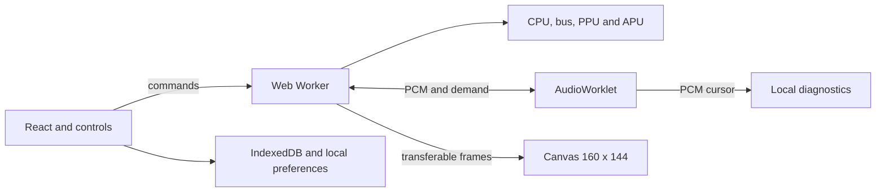

# Pocket Lab

[Português](README.md) | **English**

[](https://github.com/coder-gaia/gameboy-emulator/actions/workflows/ci.yml)

A Game Boy DMG in your browser, written in TypeScript. Play, rewind a few seconds, and explore the hardware behind every pixel.

**[Open Pocket Lab](https://gameboy-emulator-aox.pages.dev/)** · [Architecture](docs/architecture.md) · [Cartridges](docs/cartridges.md)


## Play

Choose **Tobu Tobu Girl** or **2048** from the library to start without a file. **Explorar jardim** opens POCKET GARDEN, an original diagnostic ROM without a soundtrack. Each game's controls and credits are available in the interface. The interface and technical documentation are in Brazilian Portuguese.

To load your own cartridge, select a `.gb` file or drag it onto the page. A `.gbc` file must also support the original Game Boy; extract `.zip` archives first. Use ROMs you are authorized to use. No BIOS or boot ROM is required. Files stay on your device, with no upload, account, or backend.

- **Controls:** arrow keys, Z for A, X for B, Enter for Start, and Shift for Select. Touch buttons, keyboard remapping, and standard gamepads are supported.
- **Audio:** stereo output with volume and mute. **Ativar som** requires a user gesture and AudioWorklet over HTTPS or localhost.
- **Progress:** automatic battery saves, three slots per cartridge, and `.pocketstate` file export.
- **Rewind:** up to 20 seconds of temporary history, limited to 8 MiB. Hold R or the rewind button.
- **Inspection:** CPU, disassembler, memory, tiles, sprites, registers, and local audio and performance metrics.

In the garden, arrow keys move the character, A changes its appearance, and B returns to the starting point. A hidden tab pauses execution. Saves and preferences belong to the browser and site origin; export states before clearing data or switching devices. There is no cloud synchronization.


## Architecture

One repository and one npm package, **no monorepo**. React, Vite, and CSS Modules provide the interface. The core in `src/core` uses strict TypeScript, runs in Node, and imports no DOM, React, Web Audio, or storage APIs. Four T-cycles equal one M-cycle.



The Worker advances the machine in short steps using a monotonic clock, with or without sound. AudioWorklet consumes previously generated PCM from bounded queues; each frame updates the Canvas as it arrives. The audible cursor serves diagnostics only. Buffering and the physical output can delay sound relative to the image without holding back controls.

Typed arrays and transferable buffers keep transport bounded, without SharedArrayBuffer or COOP/COEP requirements. Deployment is static on Cloudflare Pages Free. See the [architecture decisions](docs/architecture.md).

## Compatibility and limitations

| Cartridge | Maximum ROM | RAM and details                                                              |
| --------- | ----------- | ---------------------------------------------------------------------------- |
| ROM Only  | 32 KiB      | Up to 8 KiB RAM; no banking.                                                 |
| MBC1      | 2 MiB       | Up to 32 KiB RAM for ROMs up to 512 KiB; up to 8 KiB for larger ROMs.        |
| MBC2      | 256 KiB     | 512 internal nibbles.                                                        |
| MBC3      | 2 MiB       | Up to 32 KiB RAM; RTC when declared by the cartridge.                        |
| MBC5      | 8 MiB       | Up to 128 KiB RAM; rumble variants up to 64 KiB, without physical vibration. |

ROM sizes must be powers of two. The homebrew convention of 2 KiB RAM is accepted with a warning. MBC1M, MBC30, Game Boy Color exclusive games, and link cable support are outside the scope. See [cartridge formats and RTC](docs/cartridges.md).

Startup uses a post boot state. The PPU renders by scanline, without a pixel FIFO, changes during mode 3, or the quirks of WX 0 and 166. The `dmg_sound` tests check CPU observable behavior without establishing complete acoustic equivalence.

## Development

Requires Node.js 22.12 or later and npm; `.node-version` pins the build environment.

```powershell
npm.cmd ci
npx.cmd playwright install chromium
npm.cmd run dev
```

Open the address shown. These examples use `npm.cmd` in PowerShell; in other shells, use `npm` and `npx`.

```powershell
npm.cmd run check
npm.cmd run test:hardware
npm.cmd run test:e2e
npm.cmd run test:production
npm.cmd run test:audio-flow
```

`check` runs formatting, lint, tests, type checking, and the build. Hardware prepares fixtures with pinned revisions and SHA-256 hashes for 103 external cases from Blargg, Mooneye, and dmg-acid2. Production tests apply CSP to the build; audio regression covers transport, cadence, and visual response under controlled delay.

[Technical validation](docs/test-roms.md) · [Deployment](docs/deployment.md) · [Original plan](docs/plano-emulador-gameboy.md)

## Authorship and license

Created and developed by **[Alexandre Gaia](https://github.com/coder-gaia)**. Original code and documentation are available under the [MIT license](LICENSE), copyright 2026 Alexandre Gaia.

POCKET TEST and POCKET GARDEN are original project ROMs. Tobu Tobu Girl and 2048 are homebrew games with authorized redistribution. Games, fonts, icons, and dependencies retain their licenses and attributions, listed in the [third-party credits](docs/third-party.md). No commercial ROM or original boot ROM is distributed; external test ROMs are restricted to the validation suites.
