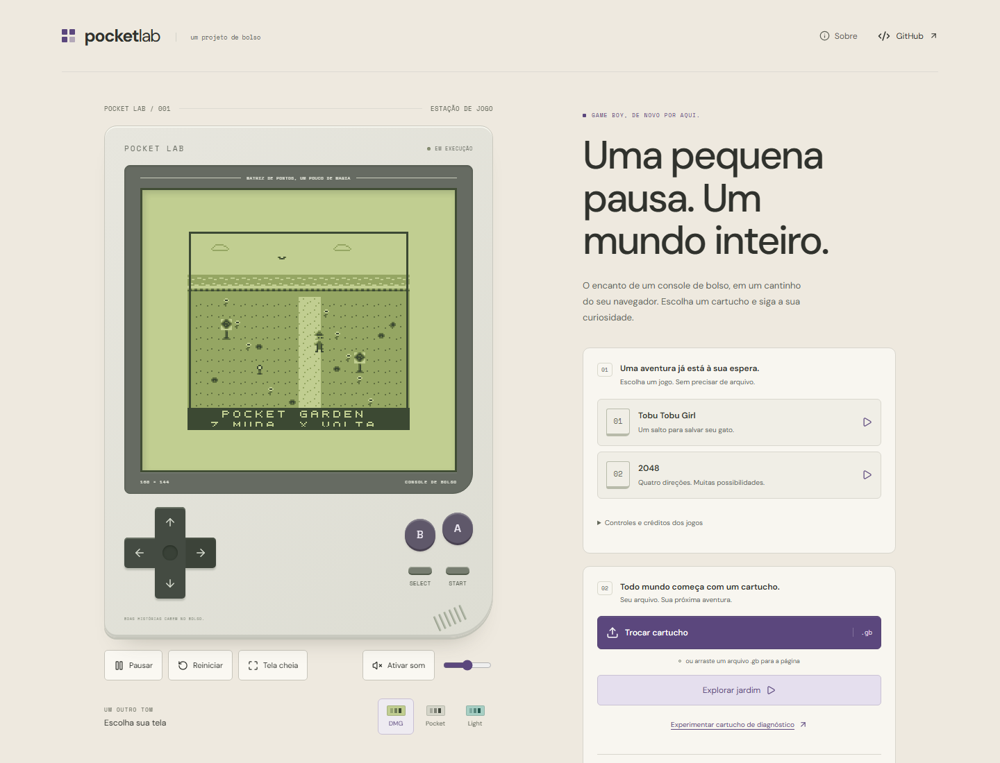
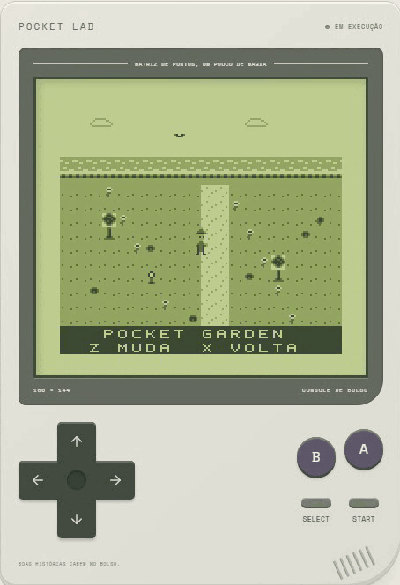
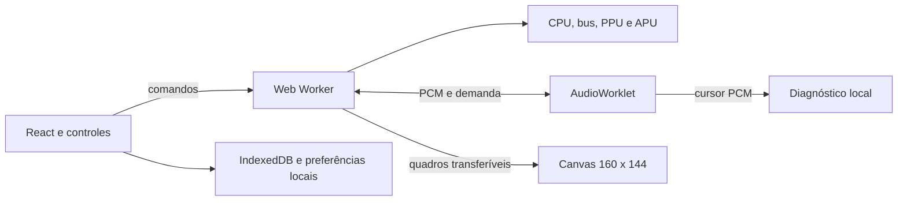

# Pocket Lab

**Português** | [English](README.en.md)

[](https://github.com/coder-gaia/gameboy-emulator/actions/workflows/ci.yml)

Um Game Boy DMG no navegador, escrito em TypeScript. Jogue, volte alguns segundos e explore o hardware que faz cada pixel acontecer.

**[Abrir Pocket Lab](https://pocketlab.alexandregaia.me/)** · [Arquitetura](docs/architecture.md) · [Cartuchos](docs/cartridges.md)



## Jogar

Escolha **Tobu Tobu Girl** ou **2048** na biblioteca para começar sem arquivo. **Explorar jardim** abre POCKET GARDEN, uma ROM original de diagnóstico, sem trilha sonora. Os controles e créditos de cada jogo estão disponíveis na interface.

Para carregar um cartucho próprio, selecione um arquivo `.gb` ou arraste-o para a página. Um `.gbc` precisa ser compatível também com o Game Boy original; extraia arquivos `.zip` antes. Use ROMs obtidas com autorização. Não é necessário fornecer BIOS ou boot ROM. Os arquivos permanecem no dispositivo, sem upload, conta ou backend.

- **Controles:** setas, Z para A, X para B, Enter para Start e Shift para Select. Há botões de toque, remapeamento de teclado e suporte a gamepad padrão.
- **Áudio:** estéreo com volume e mute. **Ativar som** exige uma ação do usuário e AudioWorklet em HTTPS ou localhost.
- **Progresso:** bateria automática, três slots por cartucho e exportação de arquivos `.pocketstate`.
- **Rewind:** até 20 segundos de histórico temporário, limitado a 8 MiB. Segure R ou o botão de voltar.
- **Inspeção:** CPU, desassemblador, memória, tiles, sprites, registradores e métricas locais de áudio e desempenho.

No jardim, as setas movem o personagem, A troca sua aparência e B retorna ao início. A aba oculta pausa a execução. Saves e preferências pertencem ao navegador e ao endereço do site; exporte estados antes de limpar dados ou trocar de dispositivo. Não há sincronização em nuvem.



## Arquitetura

Um repositório e um pacote npm, **sem monorepo**. React, Vite e CSS Modules compõem a interface. O núcleo em `src/core` usa TypeScript estrito, roda em Node e não importa DOM, React, Web Audio ou armazenamento. Quatro T-cycles equivalem a um M-cycle.



O Worker avança a máquina por relógio monotônico em passos curtos, com ou sem som. O AudioWorklet consome PCM já produzido em filas limitadas; cada quadro atualiza o Canvas ao chegar. O cursor audível serve apenas ao diagnóstico. A reserva e a saída física podem atrasar o som em relação à imagem, sem reter os controles.

Arrays tipados e buffers transferíveis mantêm o transporte limitado, sem SharedArrayBuffer ou exigência de COOP/COEP. O deploy é estático no Cloudflare Pages Free. Consulte as [decisões de arquitetura](docs/architecture.md).

## Compatibilidade e limites

| Cartucho | ROM máxima | RAM e particularidades                                               |
| -------- | ---------- | -------------------------------------------------------------------- |
| ROM Only | 32 KiB     | Até 8 KiB de RAM; sem bancos.                                        |
| MBC1     | 2 MiB      | Até 32 KiB de RAM para ROM até 512 KiB; até 8 KiB para ROM maior.    |
| MBC2     | 256 KiB    | 512 nibbles internos.                                                |
| MBC3     | 2 MiB      | Até 32 KiB de RAM; RTC quando declarado pelo cartucho.               |
| MBC5     | 8 MiB      | Até 128 KiB de RAM; variante rumble até 64 KiB, sem vibração física. |

ROMs precisam ter tamanho em potência de dois. A convenção homebrew de 2 KiB de RAM é aceita com aviso. MBC1M, MBC30, jogos exclusivos de Game Boy Color e link cable ficam fora do escopo. [Formatos de cartucho e RTC](docs/cartridges.md).

A inicialização usa o estado pós boot. A PPU renderiza por scanline, sem pixel FIFO, alterações dentro do modo 3 ou peculiaridades de WX 0 e 166. Os testes `dmg_sound` verificam o comportamento observável pela CPU, sem comprovar equivalência acústica integral.

## Desenvolvimento

Requer Node.js 22.12 ou superior e npm; `.node-version` fixa o ambiente de build.

```powershell
npm.cmd ci
npx.cmd playwright install chromium
npm.cmd run dev
```

Abra o endereço exibido. Os exemplos usam `npm.cmd` no PowerShell; em outros shells, use `npm` e `npx`.

```powershell
npm.cmd run check
npm.cmd run test:hardware
npm.cmd run test:e2e
npm.cmd run test:production
npm.cmd run test:audio-flow
```

`check` executa formatação, lint, testes, verificação de tipos e build. Hardware prepara fixtures com revisão e SHA-256 fixados para 103 casos externos de Blargg, Mooneye e dmg-acid2. Os testes de produção aplicam CSP ao build; a regressão de áudio cobre transporte, cadência e resposta visual sob atraso controlado.

[Validação técnica](docs/test-roms.md) · [Deploy](docs/deployment.md) · [Plano original](docs/plano-emulador-gameboy.md)

## Autoria e licença

Criado e desenvolvido por **[Alexandre Gaia](https://github.com/coder-gaia)**. Código e documentação próprios sob a [licença MIT](LICENSE), copyright 2026 Alexandre Gaia.

POCKET TEST e POCKET GARDEN são ROMs originais do projeto. Tobu Tobu Girl e 2048 são homebrews com redistribuição autorizada. Jogos, fontes, ícones e dependências mantêm suas licenças e atribuições, descritas nos [créditos de terceiros](docs/third-party.md). Não há ROM comercial ou boot ROM original distribuída; ROMs externas de teste ficam restritas às suítes de validação.
