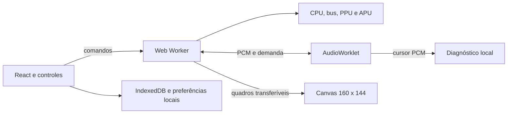

# Pocket Lab

[](https://github.com/coder-gaia/gameboy-emulator/actions/workflows/ci.yml)

Um Game Boy DMG no navegador, escrito em TypeScript. Jogue, volte alguns segundos e explore o hardware que faz cada pixel acontecer.

**[Abrir Pocket Lab](https://gameboy-emulator-aox.pages.dev/)** · [Arquitetura](docs/architecture.md) · [Cartuchos](docs/cartridges.md)


Versão **1.0.0-rc.3**, candidata a lançamento. Esta revisão separa o avanço do jogo da reprodução sonora para reduzir a demora entre toque e imagem. Em 17/10/2026, o proprietário confirmou controles rápidos e música contínua no Tobu, no Motorola Edge 40 Neo com Chrome.

## Experimente

Escolha **Tobu Tobu Girl** ou **2048** na biblioteca e comece sem arquivo. **Controles e créditos dos jogos** apresenta as ações, autores e licenças. **Explorar jardim** abre uma ROM original de diagnóstico, sem trilha sonora.

Para jogar um cartucho próprio, use **Carregar cartucho** ou arraste um arquivo `.gb`. Arquivos `.gbc` precisam funcionar também no Game Boy original; extraia `.zip` antes. A ajuda **Quais arquivos posso usar?** explica os formatos perto do carregamento. Os bytes permanecem no dispositivo, sem upload, conta ou backend. Não é necessário fornecer BIOS ou boot ROM.

| Recurso           | Como usar                                                                                                        |
| ----------------- | ---------------------------------------------------------------------------------------------------------------- |
| Teclado e toque   | Setas, Z para A, X para B, Enter para Start e Shift para Select. Remapeamento em **Controles e preferências**.   |
| Áudio estéreo     | **Ativar som** após abrir um jogo. Exige AudioWorklet em HTTPS ou localhost. Volume e mute não pausam a máquina. |
| Saves de bateria  | Progresso gravado pelo próprio jogo, salvo automaticamente neste navegador por SHA-256 do cartucho.              |
| Save states       | Três slots por cartucho e arquivos `.pocketstate`. Salvar ou carregar pausa a máquina.                           |
| Rewind            | Ative, jogue e segure R ou **Segure para voltar**. Histórico temporário de até 20 segundos, limitado a 8 MiB.    |
| Inspeção          | CPU, desassemblador, memória, 384 tiles, 40 sprites, PPU, timer, DMA, interrupções e RTC.                        |
| Diagnóstico local | **Desempenho e áudio**, medição de 60 segundos e JSON sem ROM, memória ou progresso.                             |

O jardim usa instruções SM83, tiles, mapas e OAM da máquina emulada. Setas movem o personagem, A alterna a aparência e B retorna ao início. Teclado, toque e gamepad padrão podem enviar as mesmas ações. A aba oculta pausa a execução.


Saves e preferências pertencem ao navegador e à origem do site. Limpar seus dados os remove. Exporte estados como backup antes de trocar de dispositivo ou endereço. Não há sincronização em nuvem.

## Arquitetura

Um repositório e um pacote npm, **sem monorepo**. React, Vite e CSS Modules compõem a interface; o núcleo estrito em `src/core` roda em Node e não importa DOM, React, Web Audio ou armazenamento. Quatro T-cycles equivalem a um M-cycle.



Um relógio monotônico controla o orçamento de T-cycles em passos curtos, com ou sem som. O Worklet consome PCM já produzido, mantido em filas limitadas, e a tela é atualizada ao receber os quadros atuais do jogo. O cursor audível é consultado apenas para diagnóstico. A reserva e a saída sonora podem atrasar o áudio em relação à imagem; os controles não aguardam o alto-falante. MessageChannel e transferências dispensam SharedArrayBuffer e COOP/COEP.

[Decisões de arquitetura](docs/architecture.md) reúne os contratos de execução, áudio, vídeo, persistência e inspeção.

## Compatibilidade e limites

| Cartucho | ROM máxima | RAM e particularidades                                                           |
| -------- | ---------- | -------------------------------------------------------------------------------- |
| ROM Only | 32 KiB     | Sem banking.                                                                     |
| MBC1     | 2 MiB      | Fiação padrão: até 32 KiB de RAM para ROM até 512 KiB; até 8 KiB para ROM maior. |
| MBC2     | 256 KiB    | 512 nibbles internos.                                                            |
| MBC3     | 2 MiB      | Até 32 KiB de RAM; RTC quando declarado pelo cartucho.                           |
| MBC5     | 8 MiB      | Até 128 KiB de RAM; variante rumble até 64 KiB, sem vibração física.             |

O tamanho de ROM deve ser potência de dois. A convenção homebrew de 2 KiB de RAM é aceita com aviso. MBC1M, MBC30, jogos exclusivos de Game Boy Color e link cable ficam fora do escopo. [Formatos de cartucho e RTC](docs/cartridges.md).

A PPU usa scanlines, sem pixel FIFO, mudanças dentro do modo 3 ou peculiaridades de WX 0 e 166. A inicialização pós boot não reproduz todas as revisões físicas. Os testes `dmg_sound` verificam comportamento observável pela CPU e não comprovam equivalência acústica integral. A reserva introduz latência sonora; navegador, carga e saída física também influenciam a experiência. Não há promessa de sincronismo acústico exato. Gamepad e leitores de tela físicos ainda precisam de revisão manual.

## Executar e validar

Requer Node.js 22.12 ou superior e npm. O ambiente de build está fixado em `.node-version`.

```powershell
npm.cmd ci
npx.cmd playwright install chromium
npm.cmd run dev
```

Abra o endereço exibido. Os exemplos usam `npm.cmd` para funcionar no PowerShell com scripts desabilitados; em outros shells, use `npm`.

```powershell
npm.cmd run check
npm.cmd run test:hardware
npm.cmd run test:e2e
npm.cmd run test:production
npm.cmd run test:audio-flow
```

`check` verifica regras, formatação, lint, testes locais, tipos e build. Hardware prepara fixtures com revisão e SHA-256 fixados e executa **103 casos externos** de Blargg, Mooneye e dmg-acid2. Produção aplica CSP ao artefato compilado. A regressão de transporte mede áudio, T-cycles e desenhos reais sob atraso controlado; não homologa celular físico.

[Validação técnica](docs/test-roms.md) explica a procedência das ROMs, a reprodução dos testes e os limites das medições. O [acompanhamento](docs/milestones.md) registra as entregas e os aceites. Roteiros manuais são enviados diretamente no chat; relatórios históricos permanecem no Git.

## Publicação e apresentação

O site é estático no **Cloudflare Pages Free**, conectado ao GitHub. Um push em `main` dispara o deploy, sem servidor para inicializar na visita. Download e inicialização no navegador continuam existindo. O [guia de deploy](docs/deployment.md) explica o painel, a configuração e a conferência da publicação.

O README e as capturas reais do jardim servem de base para apresentar o projeto no portfólio e no LinkedIn. A release estável e a divulgação ficam a critério do proprietário após o aceite registrado. O [plano original](plano-emulador-gameboy.md) permanece preservado.

## Conteúdo de terceiros

Não há jogo comercial ou boot ROM original distribuído. Tobu Tobu Girl e 2048 são homebrews com redistribuição autorizada, binários originais e créditos no site. [Jogos disponíveis](docs/cartridges.md) e [licenças](docs/third-party.md).

POCKET TEST e POCKET GARDEN, incluindo cenário, personagem e letras, são criações próprias. As ROMs externas de teste ficam restritas às suítes de validação. DM Sans e Space Mono são fornecidas localmente por Fontsource. [Créditos de terceiros](docs/third-party.md).

## Autoria e licença

Criado e desenvolvido por **[Alexandre Gaia](https://github.com/coder-gaia)**. Código e documentação de sua autoria sob a [licença MIT](LICENSE), copyright 2026 Alexandre Gaia.

Jogos, fontes, ícones e demais componentes de terceiros mantêm suas licenças e atribuições próprias, descritas nos [créditos](docs/third-party.md).
