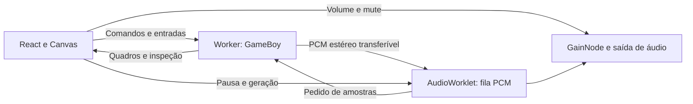

# Áudio e execução no navegador

A M07 executa a máquina Game Boy em Web Worker e entrega áudio estéreo por AudioWorklet. O núcleo permanece independente do navegador. A interface apresenta os quadros, controla a sessão e grava a bateria em IndexedDB.

## Usar o som

Escolha Tobu Tobu Girl ou 2048 e clique em **Ativar som**. O contexto de áudio é aberto a partir dessa ação explícita para atender às regras de reprodução do navegador. Se o jogo estiver pausado, use **Iniciar** para retomar a máquina.

O controle **Volume** ajusta a saída. Depois da ativação, **Silenciar** muta o som e mantém o jogo executando. O jardim POCKET GARDEN é um diagnóstico visual sem trilha sonora.

Áudio precisa de HTTPS ou localhost e de um navegador com AudioWorklet. O endereço local mostrado por `npm.cmd run dev` atende ao contexto de desenvolvimento. Um IP da rede acessado por HTTP pode não disponibilizar AudioWorklet. Quando a preparação falha ou o navegador interrompe a saída, a interface informa o problema e o Worker mantém o jogo sem som. [AudioWorklet](https://developer.mozilla.org/en-US/docs/Web/API/AudioWorklet), [contextos seguros](https://developer.mozilla.org/en-US/docs/Web/Security/Secure_Contexts), [reprodução automática](https://developer.mozilla.org/en-US/docs/Web/Media/Guides/Autoplay).

## Responsabilidade de cada parte

`src/runtime/emulator.worker.ts` possui a única instância `GameBoy` usada pela sessão. CPU, memória, mappers, timer, DMA, PPU, APU e joypad avançam no Worker. O Worker também recebe entradas e executa os comandos de inspeção manual quando a máquina está pausada.

`src/runtime/emulator-client.ts` recebe uma cópia do framebuffer, registradores e dados de apresentação. A interface não executa uma segunda máquina. Os buffers de quadros e PCM usam transferência de propriedade nas mensagens; o buffer interno do núcleo continua no Worker.

O canal PCM liga Worker e AudioWorklet diretamente por MessageChannel. A implementação não usa SharedArrayBuffer e não exige isolamento de origem por COOP/COEP. O site pode continuar sendo servido como arquivos estáticos.

## Cadência e filas

Sem saída de áudio ativa, o Worker usa `performance.now()` e orçamentos em T-cycles. O tempo acumulado é limitado para evitar recuperar uma longa interrupção de uma vez. As amostras produzidas nesse modo são descartadas, mantendo a APU avançando junto do restante do hardware.

Com áudio ativo, a demanda do AudioWorklet controla a execução. O Worker recebe a taxa real `AudioContext.sampleRate`, calcula o orçamento de ciclos para o pedido e responde com PCM `Float32Array` intercalado: esquerda, direita, esquerda, direita. A frequência de atualização do monitor não controla a velocidade da máquina.

O Worklet começa com uma reserva de 1536 frames estéreo e solicita reposições de 512 frames. Em 48 kHz, a reserva corresponde a 32 ms de PCM; a latência total também depende do navegador, do dispositivo de áudio e de seu buffer. Há somente um pedido pendente por vez, e as filas possuem capacidade fixa de 16.384 frames. Se faltar PCM, a saída restante do bloco recebe silêncio e os contadores registram a falta; se a fila exceder o limite, os dados mais antigos são descartados.

O protocolo inclui um identificador de geração, `epoch`. Pausa, reinício, troca de cartucho e reconexão limpam a fila e invalidam amostras anteriores. Isso impede que uma resposta atrasada reproduza um trecho de outra sessão. Ao pausar, a máquina e a saída de áudio são suspensas; ao retomar, uma nova reserva é preenchida. A aba oculta também pausa a execução.

## APU DMG

`src/core/apu` implementa os quatro canais:

| Canal | Geração                                 | Controles principais                  |
| ----- | --------------------------------------- | ------------------------------------- |
| CH1   | Pulso com quatro duty cycles            | Frequência, sweep, envelope e length  |
| CH2   | Pulso com quatro duty cycles            | Frequência, envelope e length         |
| CH3   | Wave RAM com 32 amostras de quatro bits | Frequência, volume por shift e length |
| CH4   | Ruído por LFSR de 15 ou 7 bits          | Divisor, shift, envelope e length     |

Os timers dos geradores usam T-cycles. O sequenciador recebe a queda real do bit 12 do contador DIV, incluindo o efeito de escrita em FF04 e o reset do divisor por STOP. O modelo inclui clocks extras de length, shadow e overflow do sweep, desativação por DAC, máscaras de leitura e regras DMG de acesso e corrupção da wave RAM. Durante power cycle, length e wave RAM são preservados conforme o comportamento DMG.

NR51 escolhe a contribuição de cada canal em cada saída, e NR50 controla os ganhos do mixer. A geração acumula as contribuições ao longo de cada intervalo de amostragem e aplica filtro passa-altas. O mixer reserva margem para transientes. A taxa de amostragem pode mudar conforme o AudioContext; os buffers de apresentação são limpos nessa mudança.

O tick da APU não aloca buffers por T-cycle. A drenagem de PCM cria o bloco transferido ao consumidor. VIN não recebe uma fonte externa no projeto.

## Validação e limites

O comando `npm.cmd run test:hardware` executa 87 testes externos: 75 das milestones anteriores e os 12 `dmg_sound`. Todas as ROMs possuem procedência, revisão, SHA-256 e protocolo em [ROMs externas de teste](test-roms.md). `dmg_sound` verifica os resultados que a CPU consegue observar, incluindo registradores e os timings associados a length, sweep, alimentação e wave RAM.

Os testes locais também verificam os geradores, o mixer estéreo, a produção de PCM por ciclos, a fila limitada, as mensagens de gerações antigas e os fluxos de ativação, volume, pausa e retomada. Essas verificações não equivalem a comparar a saída acústica com gravações de um console físico. Não há promessa de equivalência analógica integral nem de ausência de underruns em qualquer dispositivo.

O projeto usa inicialização pós boot DMG e não distribui nem executa a boot ROM original. Essa inicialização não reproduz integralmente todas as revisões físicas. A PPU continua usando renderização por scanline, sem pixel FIFO, escritas dentro do modo 3 ou as peculiaridades de janela em WX 0 e 166. A aprovação de dmg-acid2 mantém esses limites explícitos.

Save states versionados e slots ainda pertencem à M08 pendente. O grupo M06, M07 e M08 terá pausa para teste antes da M09.
