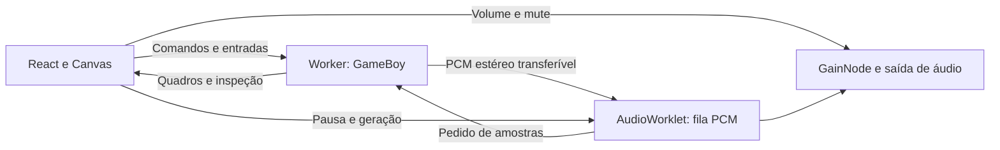

# Áudio e execução no navegador

A M07 executa a máquina Game Boy em Web Worker e entrega áudio estéreo por AudioWorklet. O núcleo permanece independente do navegador. A interface apresenta os quadros, controla a sessão e grava a bateria em IndexedDB.

## Usar o som

Escolha Tobu Tobu Girl ou 2048 e clique em **Ativar som**. O contexto de áudio é aberto a partir dessa ação explícita para atender às regras de reprodução do navegador. Se o jogo estiver pausado, use **Iniciar** para retomar a máquina.

O controle **Volume** ajusta a saída. Depois da ativação, **Silenciar** muta o som e mantém o jogo executando. O jardim POCKET GARDEN é um diagnóstico visual sem trilha sonora.

Áudio precisa de HTTPS ou localhost e de um navegador com AudioWorklet. O endereço local mostrado por `npm.cmd run dev` atende ao contexto de desenvolvimento. Um IP da rede acessado por HTTP pode não disponibilizar AudioWorklet. Quando a preparação falha ou o navegador interrompe a saída, a interface informa o problema e o Worker mantém o jogo sem som. [AudioWorklet](https://developer.mozilla.org/en-US/docs/Web/API/AudioWorklet), [contextos seguros](https://developer.mozilla.org/en-US/docs/Web/Security/Secure_Contexts), [reprodução automática](https://developer.mozilla.org/en-US/docs/Web/Media/Guides/Autoplay).

## Responsabilidade de cada parte

`src/runtime/emulator.worker.ts` possui a única instância `GameBoy` usada pela sessão. CPU, memória, mappers, timer, DMA, PPU, APU e joypad avançam no Worker. O Worker também recebe entradas e executa os comandos de inspeção manual quando a máquina está pausada.

`src/runtime/emulator-client.ts` recebe uma cópia do framebuffer, registradores e dados de apresentação. A interface não executa uma segunda máquina. Os buffers de quadros e PCM usam transferência de propriedade nas mensagens; o buffer interno do núcleo continua no Worker.

O canal PCM liga Worker e AudioWorklet diretamente por MessageChannel. A implementação não usa SharedArrayBuffer e não exige isolamento de origem por COOP/COEP. O site pode continuar sendo servido como arquivos estáticos.

## Cadência e filas

Sem saída de áudio ativa, o Worker usa `performance.now()` e orçamentos em T-cycles. O tempo acumulado é limitado para evitar recuperar uma longa interrupção de uma vez. As amostras produzidas nesse modo são descartadas, mantendo a APU avançando junto do restante do hardware.

Com áudio ativo, a demanda do AudioWorklet controla a execução. O Worker recebe a taxa real `AudioContext.sampleRate`, calcula o orçamento de ciclos para o pedido e responde com PCM `Float32Array` intercalado: esquerda, direita, esquerda, direita. A frequência de atualização do monitor não controla a velocidade da máquina.

Na M12, o Worklet começa com um alvo de aproximadamente 64 ms, arredondado em blocos de 128 frames. Solicita todo o déficit e, durante reprodução, o consumo previsto em voo a partir do maior tempo de ida e volta observado na geração atual. Uma reposição mínima de aproximadamente 10 ms evita pedidos pequenos após o priming. O tempo de ida e volta é observado em frames do próprio Worklet. O alvo pode crescer para cobrir duas vezes o atraso e dois quanta, limitado a aproximadamente 128 ms e ao teto de 16.256 frames por pedido. Em 192 kHz, esse teto corresponde a cerca de 85 ms. Há somente um pedido pendente por vez, e as filas possuem capacidade fixa de 16.384 frames. Cada pedido também respeita o crédito físico livre, com margem de 128 frames, para não descartar PCM se a resposta chegar antes do previsto.

O alvo não é um teto de ocupação: quando uma resposta chega mais cedo que a previsão conservadora, a fila pode ultrapassá-lo, permanecendo dentro da capacidade física. A simulação adversa de jitter em 48 kHz alcançou 9.600 frames, equivalentes a 200 ms. Essa folga protege a continuidade, com maior latência de saída e resposta. A latência total também depende do navegador e do dispositivo de áudio. Pausar ou reconectar inicia outra geração e limpa as estimativas. Não existe garantia contra atrasos arbitrariamente longos; em taxas altas, a mesma capacidade cobre menos tempo.

Se faltar PCM depois do primeiro priming, a saída recebe silêncio, contabiliza frames ausentes e aguarda preencher novamente a reserva. O silêncio inicial de preparação é contabilizado separadamente. Mensagens vazias de uma máquina em STOP não criam um ciclo infinito de pedidos. Consulte [investigação MB01 e regressão sob atraso](mobile-audio-investigation.md).

O protocolo inclui um identificador de geração, `epoch`. Pausa, reinício, troca de cartucho, carregamento de estado e reconexão limpam a fila e invalidam amostras anteriores. Isso impede que uma resposta atrasada reproduza um trecho de outra sessão. Ao pausar, a máquina e a saída de áudio são suspensas; ao retomar, uma nova reserva é preenchida. A aba oculta também pausa a execução.

Ao conectar, o cliente solicita uma geração acima da máquina atual e da última geração conhecida do AudioOutput reutilizado. O Worker escolhe atomicamente o maior valor entre esse piso e sua geração mais um, depois de processar comandos de reprodução já em trânsito. A resposta informa a geração efetiva usada para conectar o Worklet. Isso evita colisões entre cartuchos e a corrida entre iniciar o jogo e ativar a conexão. Pedidos repetidos de reprodução no mesmo estado não reiniciam a timeline.

Descartar PCM de apresentação preserva a fase de amostragem, o intervalo parcialmente acumulado e os capacitores do filtro da APU. Isso vale também para a execução sem som e os avanços manuais. Reiniciar a máquina ou mudar a taxa de áudio tem uma semântica própria de reinicialização do amostrador.

## Apresentação de vídeo com áudio na M14

Cada VBlank e cada mudança de ativação do LCD captura uma imagem no instante em que ocorre, mesmo quando um pedido PCM executa vários quadros. A posição da imagem é o total de PCM produzido na geração mais as amostras pendentes da APU. O observador da PPU é puro, opcional e não faz parte dos estados salvos. O orçamento de instruções e a sequência PCM permanecem os mesmos.

O Worker empresta até 32 buffers de índices de 160 por 144 pixels, totalizando 720 KiB. Os empréstimos incluem mensagens em trânsito e continuam contabilizados ao mudar de geração. Cada slot tem um token; uma devolução antiga não substitui um empréstimo novo. Sem buffer livre, o Worker descarta a imagem e continua produzindo áudio. O cliente mantém uma cópia de 22,5 KiB da imagem apresentada e devolve os buffers por transferência após copiar ou descartar.

O AudioWorklet informa a posição de PCM consumido e um instante do relógio do próprio AudioContext. Um cursor limitado ao PCM disponível orienta o requestAnimationFrame: a tela apresenta a imagem mais recente cujo instante já foi alcançado e guarda as futuras. Priming e rebuffer não avançam artificialmente o cursor. Os avisos leves de posição são independentes das estatísticas completas de 250 ms.

Os avisos do Worklet descrevem a renderização no grafo de áudio. Quando disponível e válido, getOutputTimestamp correlaciona o tempo de áudio com performance.now para estimar o instante de apresentação, sem consultar ou alocar esse objeto em cada RAF. O delta pode ser negativo porque a saída está atrás do grafo. Na ausência dessa correlação, o cliente usa currentTime, cuja progressão pode ser irregular e reduzir a suavidade. [Definição dos relógios na especificação Web Audio](https://www.w3.org/TR/webaudio-1.0/#dom-audiocontext-getoutputtimestamp).

A estimativa não comprova alinhamento acústico exato com caixas de som ou Bluetooth. Não soma arbitrariamente baseLatency e outputLatency. A reserva PCM continua introduzindo latência de resposta. Esta mudança procura preservar a frequência de apresentação, sem reduzir a reserva que protege a música.

Pausa, estado, rewind e reconexão limpam as imagens futuras junto da geração de áudio. A imagem pausada mostra o estado atual da máquina, que pode estar adiantado pela reserva PCM. Durante reprodução, a inspeção também reflete esse estado mais recente; pause para comparar tela e registradores no mesmo instante. A frequência física do monitor pode limitar quantas imagens ficam visíveis.

## APU DMG

`src/core/apu` implementa os quatro canais:

| Canal | Geração                                 | Controles principais                  |
| ----- | --------------------------------------- | ------------------------------------- |
| CH1   | Pulso com quatro duty cycles            | Frequência, sweep, envelope e length  |
| CH2   | Pulso com quatro duty cycles            | Frequência, envelope e length         |
| CH3   | Wave RAM com 32 amostras de quatro bits | Frequência, volume por shift e length |
| CH4   | Ruído por LFSR de 15 ou 7 bits          | Divisor, shift, envelope e length     |

Os timers dos geradores usam T-cycles. O sequenciador recebe a queda real do bit 12 do contador DIV, incluindo o efeito de escrita em FF04 e o reset do divisor por STOP. O modelo inclui clocks extras de length, shadow e overflow do sweep, desativação por DAC, máscaras de leitura e regras DMG de acesso e corrupção da wave RAM. Durante power cycle, length e wave RAM são preservados conforme o comportamento DMG.

NR51 escolhe a contribuição de cada canal em cada saída, e NR50 controla os ganhos do mixer. A geração acumula as contribuições ao longo de cada intervalo de amostragem e aplica filtro passa-altas. O mixer reserva margem para transientes. A taxa de amostragem pode mudar conforme o AudioContext; os buffers de apresentação são limpos nessa mudança.

O tick da APU não aloca buffers por T-cycle. A drenagem de PCM cria o bloco transferido ao consumidor. VIN não recebe uma fonte externa no projeto.

## Validação e limites

O comando `npm.cmd run test:hardware` executa 103 testes externos, incluindo os 12 `dmg_sound`. Todas as ROMs possuem procedência, revisão, SHA-256 e protocolo em [ROMs externas de teste](test-roms.md). `dmg_sound` verifica os resultados que a CPU consegue observar, incluindo registradores e os timings associados a length, sweep, alimentação e wave RAM.

Os testes locais também verificam os geradores, o mixer estéreo, a produção de PCM por ciclos, a fila limitada, as mensagens de gerações antigas e os fluxos de ativação, volume, pausa e retomada. Essas verificações não equivalem a comparar a saída acústica com gravações de um console físico. Não há promessa de equivalência analógica integral nem de ausência de underruns em qualquer dispositivo.

O projeto usa inicialização pós boot DMG e não distribui nem executa a boot ROM original. Essa inicialização não reproduz integralmente todas as revisões físicas. A PPU continua usando renderização por scanline, sem pixel FIFO, escritas dentro do modo 3 ou as peculiaridades de janela em WX 0 e 166. A aprovação de dmg-acid2 mantém esses limites explícitos.

## Áudio em estados salvos

A M08 captura timers e fases dos quatro canais, length, envelope, sweep, LFSR, wave RAM, janela de acesso, fase do sequenciador ligada ao DIV, resampler e capacitores do filtro. O núcleo restaura esses dados antes de continuar os T-cycles. Testes verificam PCM idêntico após a continuação a partir de um estado com amostragem parcial, usando a mesma taxa de áudio.

As filas PCM do núcleo e do navegador são dados de apresentação e não entram no arquivo. Carregar um estado descarta essas filas, muda a geração e mantém a partida em pausa. **Iniciar** preenche uma nova reserva; não toca o áudio que já estava pendente antes do carregamento. Volume, mute e a autorização do AudioContext continuam sendo preferências da sessão no navegador.

O estado registra a taxa de amostragem usada na captura. Com saída de áudio conectada, se o AudioContext atual usar outra taxa, o Worker adapta o amostrador para essa taxa real após restaurar a máquina. A continuidade de CPU, canais e memória é preservada, mas não se promete PCM idêntico entre taxas diferentes. Consulte [formato e limites dos estados](save-states.md).

M06, M07 e M08 foram aprovadas pelo proprietário. O [roteiro do grupo](testing-m06-m08.md) permanece como referência. A M09 acrescenta [preferências e controles](controls-and-preferences.md), preservando a ativação explícita do áudio.
